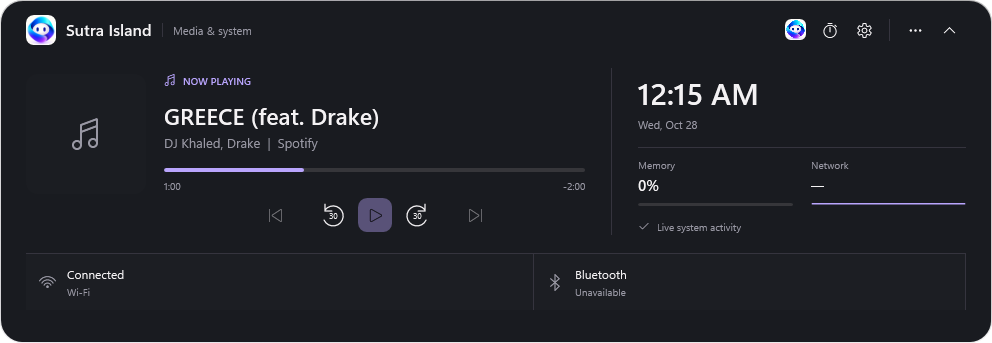
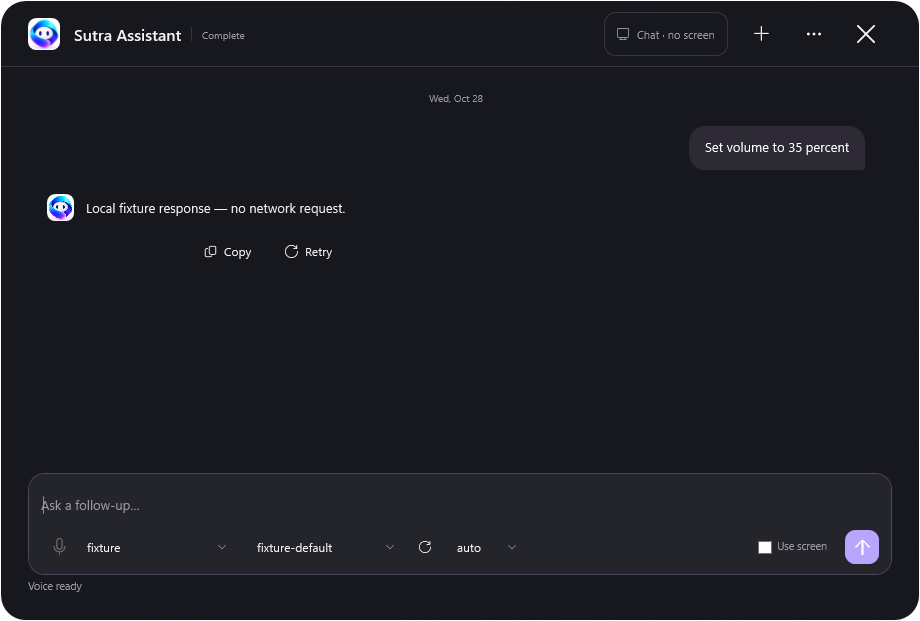
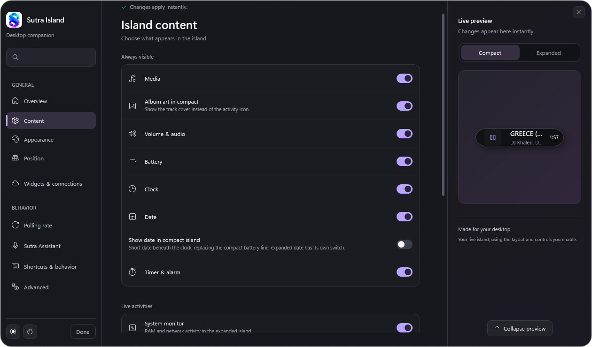
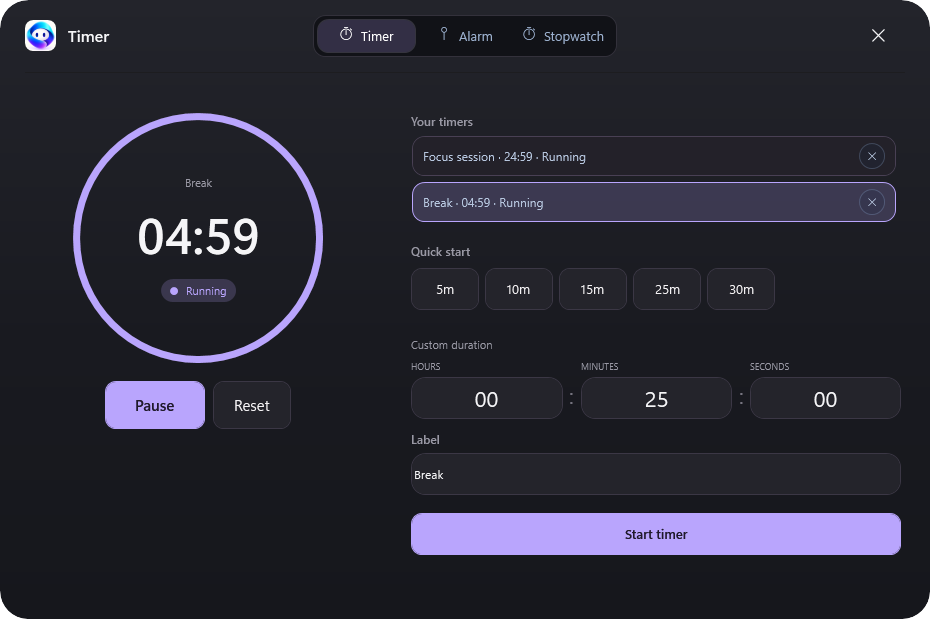
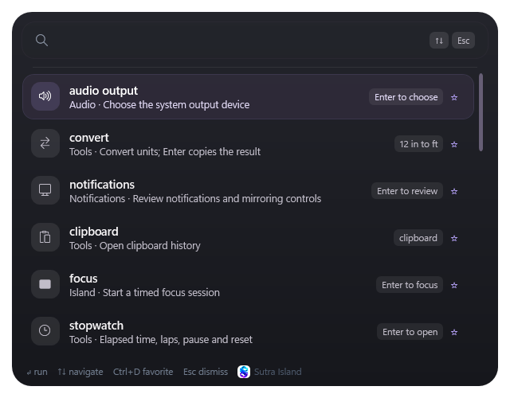
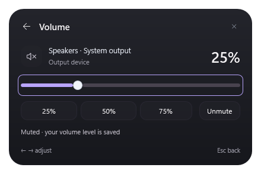
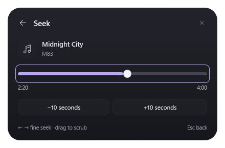
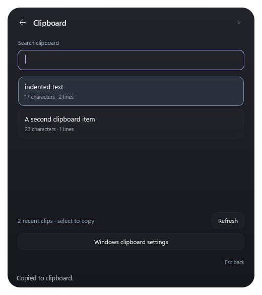
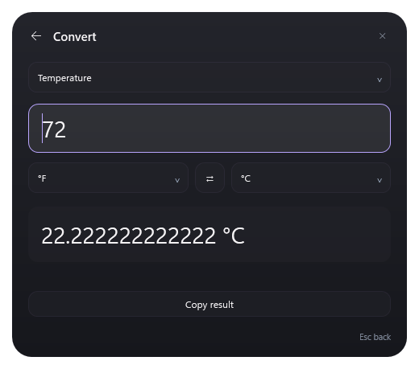
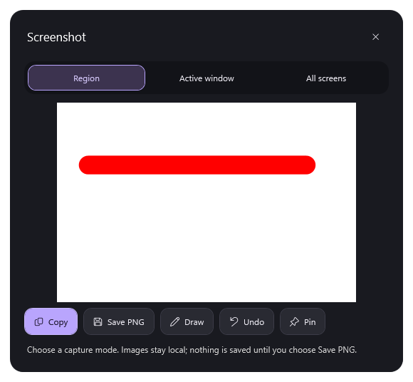

# Sutra Island for Windows

Sutra Island is a Windows desktop companion: a compact, always-on-top island that expands into media controls, system information, timers, and other live activities. It also includes Sutra Assistant and a searchable command palette.

Built with C#, WPF, and .NET 10. The current source version is **1.2.4**. See [release notes](RELEASE_NOTES.md) for changes and [Sutra Assistant](Q.md) for provider setup and privacy details.



The screenshots show the current native interface with illustrative verification data. Click a gallery image to view it at full size. Older images in `media/` are retained as historical references.

## Features

- **Media and audio:** album art, playback controls, seek and ±30-second buttons, volume, output selection, and an animated equalizer. Seek availability depends on the active media application.
- **At a glance:** clock, date, battery, memory, network, weather, and optional AirPods/compatible Beats information. Availability depends on Windows, device support, and settings. AirPods battery advertisements report ranges rather than exact percentages.
- **Timers and alarms:** named timers, alarms, a stopwatch, and a compact timer activity.
- **Sutra Assistant:** typed chat, optional local Windows voice, explicit screen help, and supported device and island actions. Choose a provider and model in Settings. Codex subscription access and API-key providers are separate options. See [Q.md](Q.md).
- **Command palette:** open with `Ctrl+Alt+K` by default to search commands and settings, control media and timers, calculate, convert units, and solve single-variable linear equations. For example, `3x+44x=1253` shows a copyable solution; nonlinear equations and systems of equations are not supported. Press Enter on a result to copy it. Use Up on an empty query to recall a previously run command.
- **Customization:** choose visible activities, appearance, position, keyboard shortcuts, and reduced-motion behavior in Settings.

## Screenshots

| Sutra Assistant | Settings and live preview |
| --- | --- |
| [](media/graphite-assistant.png) | [](media/graphite-settings.png) |
| Typed chat with optional screen context. Provider and reply labels here are test data. | Choose visible activities and preview the island as you customize it. |

| Timers, alarms, and stopwatch | Command palette |
| --- | --- |
| [](media/graphite-timer.png) | [](media/graphite-command-palette.png) |
| Manage named timers, use presets, or enter a custom duration. | Open with `Ctrl+Alt+K` to find actions and tools. |

### Command panels

| Volume | Seek |
| --- | --- |
| [](media/command-volume.png) | [](media/command-seek.png) |
| Adjust the level, choose a preset, or mute the current output. | Scrub the active track or use the panel's skip controls. |

| Clipboard history | Unit converter |
| --- | --- |
| [](media/command-clipboard.png) | [](media/command-convert.png) |
| Search recent clips and select an item to copy it. | Choose units, enter a value, and copy the live result. |

## Screenshot tool

Use **Ctrl+Alt+S**, or choose **Screenshot** in the island menu, to pick Region, Active window, or All screens before capturing. Images copy automatically; the preview offers local PNG saving, drawing, undo, and pinning. See [SCREENSHOTS.md](SCREENSHOTS.md) and [performance notes](PERFORMANCE_NOTES.md).

[](media/screenshot-preview.png)

The preview above uses a synthetic annotation example.

## Command examples

Open the palette with `Ctrl+Alt+K`, type a command, and press Enter. Calculator, conversion, and equation results are copied when selected.

| Input | Result or action |
| --- | --- |
| `5% of 1000` | `50` |
| `12 in to ft` | `1 ft` |
| `2(x+3)=14` | `x = 4` |
| `forward 30 seconds` | Seek forward in the active media app |
| `back 30 seconds` | Seek backward in the active media app |
| `screenshot` | Open local screenshot controls |
| `chat` | Open an assistant conversation |

In assistant chat, Enter sends the prompt and Shift+Enter inserts a new line.

## Getting started

Download **DynamicIsland.exe** from the [latest release](../../releases/latest). The self-contained Windows x64 executable includes the .NET runtime. Open it to start the island and use the tray menu to reach Settings or quit. Each release includes `SHA256SUMS.txt` for verifying the downloads.

For the assistant, open **Settings → Sutra Assistant**, choose a provider and model, and add an API key if required. The Codex provider uses an installed supported official Codex runtime or the separately packaged Codex test bundle. Read the [assistant guide](Q.md) before using sign-in or screen help.

Ordinary assistant chat does not automatically capture the screen. Select **Use screen** for the next question or deliberately invoke a screen-help shortcut. A screen-help session can capture context for its follow-ups until you start a regular chat or clear it. Online providers and enabled network widgets make network requests; details are documented in [Q.md](Q.md).

## Build and test

Requirements: Windows 10 version 1809 or later, Windows x64, and the .NET 10 SDK. Run these commands from this repository's root:

```powershell
dotnet restore .\DynamicIsland.slnx
dotnet build .\DynamicIsland.slnx -c Release
dotnet test .\DynamicIsland.Windows.Tests\DynamicIsland.Windows.Tests.csproj -c Release
dotnet run --project .\DynamicIsland.Windows\DynamicIsland.Windows.csproj
```

Publish a self-contained, single-file Windows x64 executable:

```powershell
dotnet publish .\DynamicIsland.Windows\DynamicIsland.Windows.csproj -c Release -r win-x64
```

The project includes its logo assets, so a source checkout does not require files from a neighboring workspace. Local SDKs, build output, and QA captures are excluded from Git. The developer-specific root-app replacement and relaunch instructions, when present, live in `AGENTS.md` in the local workspace.

## Release workflow

`.github/workflows/release.yml` runs tests and publishes a standalone executable plus a separate Codex test bundle when a matching version tag is pushed or the workflow is manually dispatched. The tag must match the version in `DynamicIsland.Windows.csproj`. The workflow also writes SHA-256 checksums; the test bundle uses a pinned, hash-verified official Codex runtime. See [CODEX_TEST_BUILD.md](CODEX_TEST_BUILD.md) and [third-party notices](THIRD_PARTY_NOTICES.md).

A source update or local build does not automatically publish a GitHub Release. Review screenshots and release artifacts before sharing; local QA captures may contain private desktop content and are ignored by Git.

See the [release review](RELEASE_REVIEW.md) for the checks performed for v1.1.9 and the remaining device and account testing limits.

## Repository layout

- `DynamicIsland.Windows/` — WPF application, views, services, Windows interop, and packaged assets.
- `DynamicIsland.Q.Core/` — assistant contracts, prompt composition, and session logic.
- `DynamicIsland.Windows.Tests/` — xUnit tests for app logic.
- `scripts/` — release packaging and verification helpers.
- `media/` — existing screenshots and historical visuals.
- `python-versions/` — archived Python prototypes.
- [RELEASE_NOTES.md](RELEASE_NOTES.md), [Q.md](Q.md), [CUSTOM_THEME.md](CUSTOM_THEME.md), and [design-qa.md](design-qa.md) — release history and additional guides.

## License

[MIT](LICENSE). See [THIRD_PARTY_NOTICES.md](THIRD_PARTY_NOTICES.md) for third-party components.
